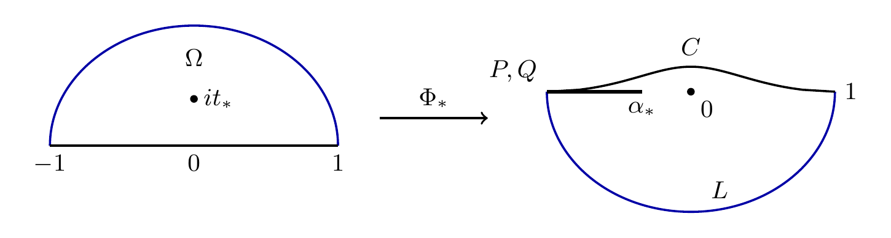

# The Exact Stabilizability Threshold for the Belgian Chocolate Problem

**Xiang Ji**, **Long Wang**, and **Wensheng Yu**

Xiang Ji and Wensheng Yu · School of Electronic Engineering, Beijing University of Posts and Telecommunications  
Long Wang · Center for Systems and Control, College of Engineering, Peking University

English · [中文](README.zh-CN.md)

Project affiliation: Intelligent Information Processing Laboratory, Beijing University of Posts and Telecommunications (北京邮电大学 智能信息处理实验室).

**Initial Lean formalization commit: 2026-11-25 · [4006bec](https://github.com/Jxxxx-2001/belgian-chocolate-lean/commit/4006bec3e7f41c605a9bcd07d28d90fc4261b292).**

**Content updated: 2026-11-28.**

This repository accompanies the manuscript and contains Lean 4 proofs of the exact threshold and the two fixed-degree results, together with a rational controller certificate.

[Lean main theorem](formalization/BelgianChocolateThreshold.lean#L89) · [Axiom audit](formalization/BelgianChocolateThresholdAudit.lean) · [Reproduction instructions](formalization/REPRODUCE.md)

## The problem

In the polynomial formulation of Blondel's simultaneous stabilization problem, fix 0 &lt; δ &lt; 1. Seek nonzero real polynomials x, y with deg y ≤ deg x such that x, y, and

Z(s) = (s² − 2δs + 1)x(s) + (s² − 1)y(s)

are strictly Hurwitz stable, meaning that each zero has strictly negative real part. The finite-order controller is y/x. [Lean definition](formalization/ControllerFeasible.lean#L11)

## Main results

| Result | Statement | Lean |
| --- | --- | --- |
| Finite-order stabilization | The feasible parameters are exactly (0, δ∗). The supremum δ∗ is unattained. | [Interval and endpoint](formalization/BelgianChocolateThreshold.lean#L38) |
| Disk interpolation | The feasible parameters are exactly [t∗, 1). At t = t∗ there are exactly two interpolants, f∗(z) and f∗(−z), with f∗′(0) &gt; 0. | [Interval and endpoint classification](formalization/MarkedCompetitorComparison.lean#L236) |
| Exact threshold formula | Let d∗ be the harmonic measure at 0 of the lower unit semicircle in the unique balanced slit domain. Then t∗ = tan(πd∗/4) and δ∗ = cos(πd∗/2) = (1 − t∗²)/(1 + t∗²). | [Balanced slit](formalization/BalancedSlitRoot.lean#L101) · [Exact formulas](formalization/BelgianChocolateThreshold.lean#L32) |
| Example 6.1 — Sixth-order counterexample | With a degree-six denominator and a constant numerator, every feasible parameter is below √(11/12). With a degree-six numerator and denominator, some parameter above 0.96295 is feasible. | [Refutation](formalization/Conjecture2.lean#L377) · [Strict gap](formalization/Conjecture2.lean#L363) |
| Theorem 6.2 — Sharpness of the continued-fraction bound | For a constant numerator and denominator degree n ≥ 1, let δn∗ be the feasible supremum. Every feasible parameter is strictly below δn = cos(π/[2(n + 1)]). The supremum equals this bound for n = 1, 2, 3, 4 and is strictly smaller for n ≥ 5. | [Continued-fraction bound](formalization/ContinuedFractionBound.lean#L73) · [Equality classification](formalization/Conjecture3Equality.lean#L8) |

For δ in [0, 1], the manuscript also includes δ = 0, giving the feasible set [0, δ∗). A controller at zero is given by x(s) = s + 1 and y(s) = 1/2. The linked Lean threshold theorem uses positive parameters.

The numerical approximation δ∗ ≈ 0.987237027 comes from Muhan Liu's evaluation of the harmonic measure and balance equation (preprint, Section 6). [Liu's preprint](https://www.alphaxiv.org/abs/2611.generalized-belgian-chocolate-stabilization.pdf)

## Research background

- **1994.** Vincent Blondel posed the problem in the study of simultaneous stabilization. The polynomial formulation asks when a stable, minimum-phase rational controller can stabilize a particular second-order plant. [Blondel’s monograph, pp. 149–150](https://link.springer.com/book/10.1007/3-540-19862-8)
- **2008.** Guannan He, Long Wang, and Wensheng Yu used automated inequality proving to obtain explicit parameter bounds for fixed-order stabilizing controllers and formulated two conjectures for the Belgian Chocolate Problem. [IFAC paper](https://doi.org/10.3182/20080706-5-KR-1001.00191)
- **2011.** Qiang Guan, Guannan He, Long Wang, and Wensheng Yu reviewed the Belgian Chocolate Problem from the perspectives of theoretical bounds and controller design. Section 5 describes how a single threshold separates feasible and infeasible parameters. [*Control Theory & Applications* 28(1), 1–12](https://www.oalib.com/journal/3455/11)
- **2013.** Walter Bergweiler and Alexandre Eremenko formulated the associated holomorphic interpolation problem on the unit disk and proved the upper bound δ∗ &lt; 0.999579. [*Gol’dberg’s Constants*, §11](https://www.math.purdue.edu/~eremenko/dvi/goldbergconst.pdf)
- **2014.** Wang Li and Wensheng Yu used elliptic modular functions and lengths of hyperbolic closed geodesics to refine a parameter estimate based on the Hempel–Smith bound. [CCDC paper](https://doi.org/10.1109/CCDC.2014.6852192)
- **2016.** Wang Li, Long Wang, and Wensheng Yu surveyed analytical and numerical bounds for the Belgian Chocolate Problem, including bounds for fixed controller orders. [*Journal of Systems Science & Complexity* 29(2), 289–299](https://doi.org/10.1007/s11424-015-4182-1)
- **2018.** Zachary Charles and Nigel Boston proved that δ = 0.9808348 is feasible using the algebraic structure of the stabilization equations. [Charles and Boston, Theorem 5.1](https://arxiv.org/abs/1708.08114)
- **2026.** Xuandi Cheng gave an exact polynomial certificate for feasibility at δ = 0.9846316110433085. Muhan Liu derived the same exact threshold as the accompanying manuscript using a modular covering and a Cauchy integral argument. [Cheng’s certificate](https://github.com/chengxuandi/belgian-chocolate-certified-lower-bound/tree/362cf25a04ebd0468b05153008ba72dca7f09ef6) · [Liu’s preprint](https://www.alphaxiv.org/abs/2611.generalized-belgian-chocolate-stabilization.pdf)

## Proof outline

**Exact threshold.** The Cayley transform reduces stabilization to disk interpolation. The unique balanced slit gives an extremal candidate, and two explicit annuli determine the boundary markings of the competing lifts. A comparison of harmonic primitives proves the disk threshold and endpoint classification. Polynomial approximation gives finite-order controllers below the threshold, and the extremal interpolant's boundary behavior excludes a finite-order controller at the threshold.

**Figure 1.** The two halves of the diameter and the upper semicircle correspond to C, the two slit banks, and L, respectively. At balance, C and the two banks have the same total harmonic measure at 0.

A certified degree-28 rational controller gives feasibility at δw = 98236947/10⁸. Its associated disk parameter satisfies tw &lt; 1/10. The comparison argument gives t∗ ≤ tw, so it covers every positive parameter up to t∗. [Lean witness](formalization/ControllerFeasible.lean#L34) · [Independent Schur verification](verification/README.md)

**Example 6.1.** A sign condition for the odd coefficients of a Hurwitz sextic excludes constant numerators at and above the stated bound. An algebraic identity and a Möbius transformation produce a strictly stable degree-six witness. [Lean witness construction](formalization/Degree6Witness.lean)

**Theorem 6.2.** Chebyshev polynomials give the largest positive root of the continued fraction. At degrees one through four, explicit stable families approach the bound. At higher degrees, the limiting polynomial forces an extra right-half-plane root, ruling out approach to the bound. [Low-degree construction](formalization/LowDegreeSharpness.lean#L234) · [Higher-degree obstruction](formalization/HighDegreeGap.lean#L17)

## Lean 4 formalization

The project uses Mathlib and Tau Ceti and contains 160 Lean files with 21,726 source lines, excluding dependencies. The threshold theorem and the final declarations for Example 6.1 and Theorem 6.2 depend only on `propext`, `Classical.choice`, and `Quot.sound`. [Reproduction and axiom checks](formalization/REPRODUCE.md)

## Citation

Xiang Ji, Long Wang, and Wensheng Yu, *The Exact Stabilizability Threshold for the Belgian Chocolate Problem*, manuscript, 2026. When citing the Lean formalization, include the repository commit you used.
