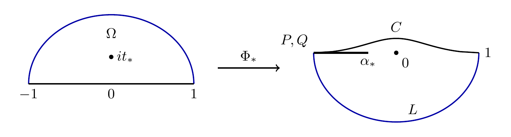

# 比利时巧克力问题的精确可镇定性阈值

**Xiang Ji、Long Wang、Wensheng Yu**

Xiang Ji、Wensheng Yu · 北京邮电大学电子工程学院  
Long Wang · 北京大学工学院系统与控制中心

[English](README.md) · 中文

项目单位：北京邮电大学 智能信息处理实验室（Intelligent Information Processing Laboratory, Beijing University of Posts and Telecommunications）。

**Lean 形式化首次提交：2026-11-25 · [4006bec](https://github.com/Jxxxx-2001/belgian-chocolate-lean/commit/4006bec3e7f41c605a9bcd07d28d90fc4261b292)。**

**内容更新：2026-11-28。**

本仓库配套论文，包含精确阈值与两个固定阶结果的 Lean 4 证明，以及有理控制器证书。

[Lean 主定理](formalization/BelgianChocolateThreshold.lean#L89) · [公理审计](formalization/BelgianChocolateThresholdAudit.lean) · [复现说明](formalization/REPRODUCE.md)

## 问题

在 Blondel 同时镇定问题的多项式表述中，给定 0 &lt; δ &lt; 1，寻找非零实多项式 x, y，使 deg y ≤ deg x，且 x、y 和

Z(s) = (s² − 2δs + 1)x(s) + (s² − 1)y(s)

均严格 Hurwitz 稳定，即各自的所有零点都具有严格负的实部。有限阶控制器为 y/x。 [Lean 定义](formalization/ControllerFeasible.lean#L11)

## 主要结论

| 结论 | 表述 | Lean |
| --- | --- | --- |
| 有限阶控制器镇定 | 可行参数恰为 (0, δ∗)，上确界 δ∗ 不可达。 | [区间与端点](formalization/BelgianChocolateThreshold.lean#L38) |
| 圆盘插值 | 可行参数恰为 [t∗, 1)。在 t = t∗ 处恰有两个插值函数 f∗(z) 和 f∗(−z)，其中 f∗′(0) &gt; 0。 | [区间与端点分类](formalization/MarkedCompetitorComparison.lean#L236) |
| 精确阈值公式 | 令 d∗ 为唯一平衡裂缝域中单位下半圆在原点处的调和测度。则 t∗ = tan(πd∗/4)，且 δ∗ = cos(πd∗/2) = (1 − t∗²)/(1 + t∗²)。 | [平衡裂缝](formalization/BalancedSlitRoot.lean#L101) · [精确公式](formalization/BelgianChocolateThreshold.lean#L32) |
| 例 6.1：六阶反例 | 分母为六阶、分子为常数时，可行参数均小于 √(11/12)。分子和分母均为六阶时，存在大于 0.96295 的可行参数。 | [反例定理](formalization/Conjecture2.lean#L377) · [严格差距](formalization/Conjecture2.lean#L363) |
| 定理 6.2：连分式上界的尖锐性 | 设分子为常数、分母阶数为 n ≥ 1，可行参数的上确界为 δn∗。每个可行参数都严格小于 δn = cos(π/[2(n + 1)])。一至四阶的上确界等于该界，五阶及以上严格小于该界。 | [连分式上界](formalization/ContinuedFractionBound.lean#L73) · [等号分类](formalization/Conjecture3Equality.lean#L8) |

若在 [0, 1] 中考虑参数，稿件还纳入 δ = 0，可行集为 [0, δ∗)。零参数的见证为 x(s) = s + 1、y(s) = 1/2。上表链接的 Lean 阈值定理采用正参数定义。

数值近似 δ∗ ≈ 0.987237027 取自 Muhan Liu 的预印本第 6 节对调和测度和平衡方程的数值计算。 [Liu 的预印本](https://www.alphaxiv.org/abs/2611.generalized-belgian-chocolate-stabilization.pdf)

## 研究背景

- **1994 年。** Vincent Blondel 在同时镇定研究中提出了这一问题。其多项式表述考察何时可用稳定且为最小相位的有理控制器镇定一个特定的二阶被控对象。 [Blondel 专著，第 149–150 页](https://link.springer.com/book/10.1007/3-540-19862-8)
- **2008 年。** 何冠男、王龙和郁文生利用不等式型定理机器证明，给出固定阶镇定控制器存在的显式参数界，并提出关于比利时巧克力问题的两个猜想。 [IFAC 会议论文](https://doi.org/10.3182/20080706-5-KR-1001.00191)
- **2011 年。** 关强、何冠男、王龙和郁文生从理论界与控制器设计两方面综述了比利时巧克力问题。第 5 节说明了可行区间与不可行区间由同一个阈值划分。 [《控制理论与应用》28(1)，1–12](https://www.oalib.com/journal/3455/11)
- **2013 年。** Walter Bergweiler 与 Alexandre Eremenko 给出了相应的单位圆盘全纯插值问题，并证明阈值上界 δ∗ &lt; 0.999579。 [*Gol’dberg’s Constants*，第 11 节](https://www.math.purdue.edu/~eremenko/dvi/goldbergconst.pdf)
- **2014 年。** Wang Li 和郁文生利用椭圆模函数与双曲闭测地线长度，细化了基于 Hempel–Smith 界的参数估计。 [中国控制与决策会议论文](https://doi.org/10.1109/CCDC.2014.6852192)
- **2016 年。** Wang Li、王龙和郁文生梳理了比利时巧克力问题的理论界和数值界，其中包括固定控制器阶数下的参数界。 [*Journal of Systems Science & Complexity* 29(2)，289–299](https://doi.org/10.1007/s11424-015-4182-1)
- **2018 年。** Zachary Charles 与 Nigel Boston 利用镇定方程的代数结构，证明 δ = 0.9808348 可行。 [Charles 与 Boston，定理 5.1](https://arxiv.org/abs/1708.08114)
- **2026 年。** 程煊笛给出了 δ = 0.9846316110433085 可行的精确多项式证书。Muhan Liu 利用模覆盖和 Cauchy 积分得到了与本仓库配套论文相同的精确阈值。 [程煊笛的证书](https://github.com/chengxuandi/belgian-chocolate-certified-lower-bound/tree/362cf25a04ebd0468b05153008ba72dca7f09ef6) · [Liu 的预印本](https://www.alphaxiv.org/abs/2611.generalized-belgian-chocolate-stabilization.pdf)

## 证明路线

**精确阈值。** 先用 Cayley 变换将原问题化为圆盘插值，再由唯一的平衡裂缝构造极值候选。两个显式环域确定竞争函数提升的边界标记。比较调和原函数得到阈值与圆盘端点分类。多项式逼近给出阈值以下的有限阶控制器，极值函数的边界行为排除阈值处的有限阶实现。

**图 1**　直径的两半与上半圆弧依次对应曲边 C、裂缝两岸和下半圆弧 L。达到平衡时，C 的调和测度等于裂缝两岸的调和测度之和。

经验证的 28 阶有理控制器给出可行参数 δw = 98236947/10⁸，对应的圆盘参数满足 tw &lt; 1/10。由比较论证得到 t∗ ≤ tw，因此该论证覆盖所有不超过 t∗ 的正参数。 [Lean 见证](formalization/ControllerFeasible.lean#L34) · [独立 Schur 验证](verification/README.md)

**例 6.1。** 利用六次 Hurwitz 多项式奇次系数的符号条件，排除达到该界及以上的常数分子情形。再用代数恒等式和 Möbius 变换构造严格稳定的六阶见证。 [Lean 见证构造](formalization/Degree6Witness.lean)

**定理 6.2。** 利用 Chebyshev 多项式求连分式的最大正根。一至四阶构造严格稳定的多项式族逼近该界。五阶及以上则由极限多项式的额外开右半平面根排除逼近。 [低阶构造](formalization/LowDegreeSharpness.lean#L234) · [高阶障碍](formalization/HighDegreeGap.lean#L17)

## Lean 4 形式化

工程使用 Mathlib 和 Tau Ceti，仓库内共有 160 个 Lean 文件、21,726 行源码。全局阈值主定理以及例 6.1、定理 6.2 所对应的最终声明均只依赖 `propext`、`Classical.choice` 和 `Quot.sound`。 [构建与公理检查](formalization/REPRODUCE.md)

## 引用

Xiang Ji、Long Wang、Wensheng Yu，《比利时巧克力问题的精确可镇定性阈值》，2026 年稿。引用 Lean 形式化时，请注明所使用的仓库提交。
